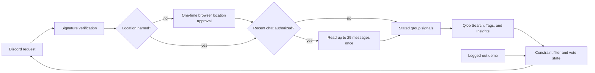

<p align="center"></p>

<h1 align="center">Encore</h1>

<p align="center"><strong>Group chats have ideas. Encore gets a plan.</strong></p>

<p align="center">
  <a href="https://encore.encore-tanishmisra9.workers.dev">Live demo</a> ·
  <a href="https://encore.encore-tanishmisra9.workers.dev/demo.html">Try the plan flow</a> ·
  <a href="docs/evaluation.md">Evaluation</a> ·
  <a href="docs/submission-draft.md">Write-up</a>
</p>

<p align="center">
  <a href="https://github.com/tanishmisra9/encore/actions/workflows/ci.yml"></a>
  
  
</p>

Live at **https://encore.encore-tanishmisra9.workers.dev**. No login needed.

Encore is a Discord agent for local social plans. A group asks what to do nearby, optionally authorizes a one-time read of its recent chat, and receives a Qloo-grounded shortlist it can vote on or revise.

## What it does

- Starts with `/encore ask:"what should we do tonight?" use_recent_chat:true`. If no location is named, Encore sends the initiator a private, one-time browser link to share current location (no IP guessing).
- Reads at most 25 recent messages only when `use_recent_chat:true` is selected.
- Retains explicit tastes and practical limits, then discards raw message content.
- Uses Qloo entity search, tags, and Insights to find nearby cultural overlap, then shows which members each place bridges and through which Qloo tag.
- Enforces distance, budget, current votes, plan ownership, and expiry in TypeScript.
- Separates group-fit reasoning from practical facts and marks unavailable details as unconfirmed. A place with an unknown price is kept and labeled, not silently dropped.

## Architecture



| Decision | Owner | Guardrail |
| --- | --- | --- |
| Resolve current location | Browser permission | No IP location; one-time handoff expires in 10 minutes |
| Extract stated signals | Model or parser | Raw Discord text is not stored |
| Cultural and local matching | Qloo | Production fails visibly when Qloo is unavailable |
| Budget, radius, vote validity | TypeScript | Filters run before users vote |
| Final choice | Group | One current vote per member |
| Hours, availability, booking | Human | Unknown details stay unconfirmed |

## Run locally

```sh
npm install
npx wrangler d1 migrations apply encore --local
npm run dev
```

Run checks:

```sh
npm run check     # TypeScript
npm test          # unit and integration tests, offline
BASE_URL=http://localhost:8787 node test/browser.mjs   # web demo and location page in a real browser
npm run sandbox   # full Discord flow against a local mock Discord, with live Qloo
```

The browser test uses `?fixture=1`, which the Worker accepts only on localhost. Deployed requests require `QLOO_API_KEY` and never fall back to fixture recommendations. When a Discord request has no named location, the command responds privately with a 10-minute link to `/locate.html`; that page requests browser location permission and posts the resulting plan to the originating channel.

## Configure Discord and Qloo

```text
DISCORD_APPLICATION_ID=<application id>
DISCORD_PUBLIC_KEY=<public key>
DISCORD_BOT_TOKEN=<bot token>
QLOO_API_KEY=<hackathon key>
```

Enable Message Content Intent. Grant View Channels, Send Messages, Read Message History, and application-command access. Configure the interaction endpoint:

```text
https://<worker>.<subdomain>.workers.dev/discord/interactions
```

Register the command after setting the bot token:

```sh
npm run discord:register
```

`DISCORD_API_BASE` is only used by the sandbox. Set production secrets through Wrangler:

```sh
npx wrangler secret put DISCORD_BOT_TOKEN
npx wrangler secret put QLOO_API_KEY
```

## Discord sandbox

`npm run sandbox` tests the Discord flow without a Discord server or bot token. It starts a mock Discord API, signs interactions with its own Ed25519 key, boots the real Worker with a fresh local database, and runs 16 checks: signature enforcement, the location handoff in a real browser with granted geolocation, one-time links, votes, replan, channel isolation, and a canary check that raw chat text never reaches the database. It uses the live Qloo API, so it needs `QLOO_API_KEY` in `.dev.vars`.

## Demo and evidence

The public homepage is a silent replay. `/demo.html` is the focused live flow. The evaluation compares Qloo against a popularity baseline with the same location and constraints and publishes its misses; the protocol and results are in [`docs/evaluation.md`](docs/evaluation.md). The submission draft and skeptical judge audit are in [`docs/submission-draft.md`](docs/submission-draft.md) and [`docs/judge-audit.md`](docs/judge-audit.md).

## License

[MIT](LICENSE)
