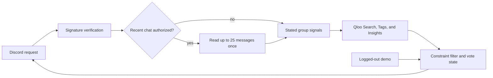

# Encore

**Group chats have ideas. Encore gets a plan.**

Encore is a Discord agent for local social plans. A group asks what to do nearby, optionally authorizes a one-time read of its recent chat, and receives a Qloo-grounded shortlist it can vote on or revise.

## What it does

- Starts with `/encore ask:"what should we do in Williamsburg tonight?"`.
- Reads at most 25 recent messages only when `use_recent_chat:true` is selected.
- Retains explicit tastes and practical limits, then discards raw message content.
- Uses Qloo entity search, tags, and Insights to find nearby cultural overlap.
- Enforces distance, budget, current votes, plan ownership, and expiry in TypeScript.
- Separates group-fit reasoning from practical facts and marks unavailable details as unconfirmed.

## Architecture



| Decision | Owner | Guardrail |
| --- | --- | --- |
| Extract stated signals | Model or parser | Raw Discord text is not stored |
| Cultural and local matching | Qloo | Production fails visibly when Qloo is unavailable |
| Budget, radius, vote validity | TypeScript | Filters run before users vote |
| Final choice | Group | One current vote per member |
| Hours, availability, booking | Human | Unknown details stay unconfirmed |

## Run locally

```sh
npm install
npx wrangler d1 migrations apply encore --local
npm run dev
```

Run checks:

```sh
npm run check
npm test
BASE_URL=http://localhost:8787 node test/browser.mjs
```

The browser test uses `?fixture=1`, which the Worker accepts only on localhost. Deployed requests require `QLOO_API_KEY` and never fall back to fixture recommendations.

## Configure Discord and Qloo

```text
DISCORD_APPLICATION_ID=<application id>
DISCORD_PUBLIC_KEY=<public key>
DISCORD_BOT_TOKEN=<bot token>
QLOO_API_KEY=<hackathon key>
```

Enable Message Content Intent. Grant View Channels, Send Messages, Read Message History, and application-command access. Configure the interaction endpoint:

```text
https://<worker>.<subdomain>.workers.dev/discord/interactions
```

Register the command after setting the bot token:

```sh
npm run discord:register
```

Set production secrets through Wrangler:

```sh
npx wrangler secret put DISCORD_BOT_TOKEN
npx wrangler secret put QLOO_API_KEY
```

## Demo and evidence

The public homepage is a silent replay. `/demo.html` is the focused live flow. The fixed evaluation protocol, including a Qloo versus OpenAI-only blind comparison, is in [`docs/evaluation.md`](docs/evaluation.md). The submission draft and skeptical judge audit are in [`docs/submission-draft.md`](docs/submission-draft.md) and [`docs/judge-audit.md`](docs/judge-audit.md).

## License

[MIT](LICENSE)
