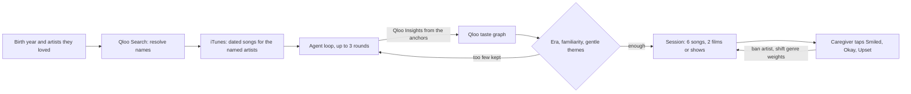

<p align="center"></p>

<h1 align="center">Memory Lane</h1>

<p align="center"><strong>The right song isn't the popular one. It's the one from when they were 19.</strong></p>

<p align="center">
  <a href="https://memory-lane.encore-tanishmisra9.workers.dev">Live demo</a> ·
  <a href="docs/evaluation.md">Evaluation</a> ·
  <a href="docs/submission-draft.md">Write-up</a>
</p>

<p align="center">
  <a href="https://github.com/tanishmisra9/memory-lane/actions/workflows/ci.yml"></a>
  
  
</p>

**Try it: https://memory-lane.encore-tanishmisra9.workers.dev** (no login, one tap on an example).

Memory Lane helps a family caregiver run a short music-and-memories session with someone who has dementia. Enter their birth year and one to three artists they loved. It finds songs, films and shows from when they were about 10 to 30, in their own culture, plays 30-second previews, and adapts as the caregiver taps how each one landed.

Built for the [Qloo Agentic Hackathon](https://qloo.devpost.com/). It started as a Discord planner (still on the [`v1-discord`](https://github.com/tanishmisra9/memory-lane/tree/v1-discord) branch) and was rebuilt as a web app that judges can use directly.

## How it works



| Decision | Owner | Guardrail |
| --- | --- | --- |
| Which artists, films and shows are near what they loved | Qloo Insights, Search | A Qloo failure is shown, never replaced by a generic list |
| Which are from their youth (born +10 to +30) | Code | Unknown start year is excluded |
| Which are familiar and gentle | Code | Obscure, complex, or upsetting lyrical themes are removed |
| Whether a song can be played | iTunes preview match | Artist name must match; songs without audio are swapped out |
| What to do after a reaction | Code | Upset bans the artist; weights stay within 0.25 to 2 |
| Conversation prompts | Fixed templates | Filled from real titles; nothing is generated |

No language model is involved anywhere. The agent loop queries Qloo, filters by era and safety in code, re-anchors on artists it has not used yet, and repeats until it has 15 safe artists or three rounds. The trace is under "How it chose" on the page.

**Limits.** Qloo has no per-song data, so songs from found artists show the ages the artist was active, not a release year (named artists get exact years from iTunes). About 4% of songs lack a preview. Films and shows are weaker matches than music. It is not therapy and makes no medical claims.

## Run it

```sh
npm install
echo "QLOO_API_KEY=<hackathon key>" > .dev.vars
npx wrangler d1 migrations apply memory-lane --local
npm run dev            # http://localhost:8787
```

```sh
npm run check          # TypeScript
npm test               # 19 unit tests, offline
npm run e2e            # real browser, desktop and mobile, against a running server
npm run eval           # three-arm evaluation on eight personas (live Qloo)
```

`BASE_URL=https://memory-lane.encore-tanishmisra9.workers.dev npm run e2e` runs the same browser test against production. It checks audio on every song strip, no horizontal scroll, no rounded or pill shapes, 44px touch targets, upset and smiled reactions, the printable summary, deletion, and the form's error paths.

Deploy with `npx wrangler d1 create memory-lane`, put the id in `wrangler.jsonc`, run `npx wrangler d1 migrations apply memory-lane --remote`, `npx wrangler secret put QLOO_API_KEY`, then `npm run deploy`.

## Privacy

A birth year, up to three artist names and an optional first name. No health data, no accounts, no location. Sessions expire after 30 days and can be deleted from the page. Qloo responses are cached privately on the server and are not stored in this repository.

## License

[MIT](LICENSE)
